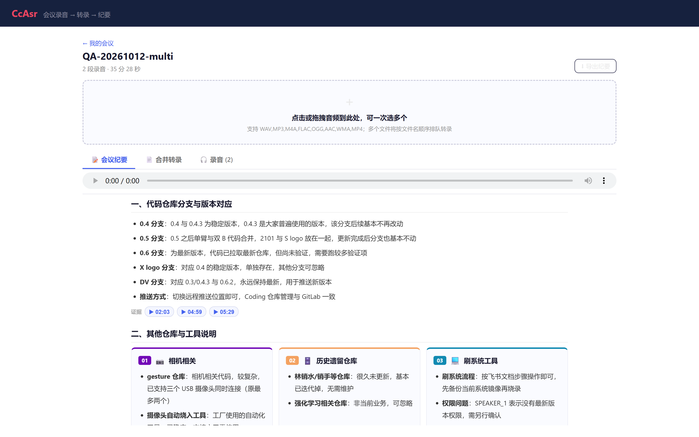
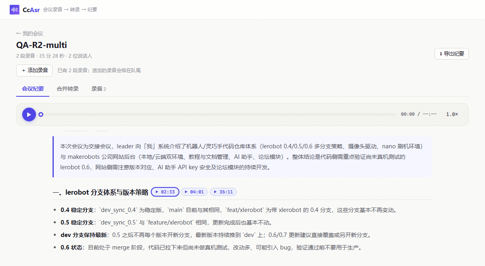
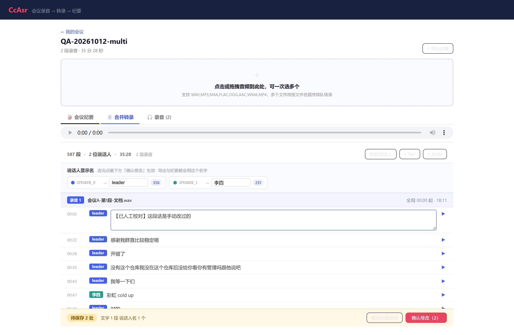
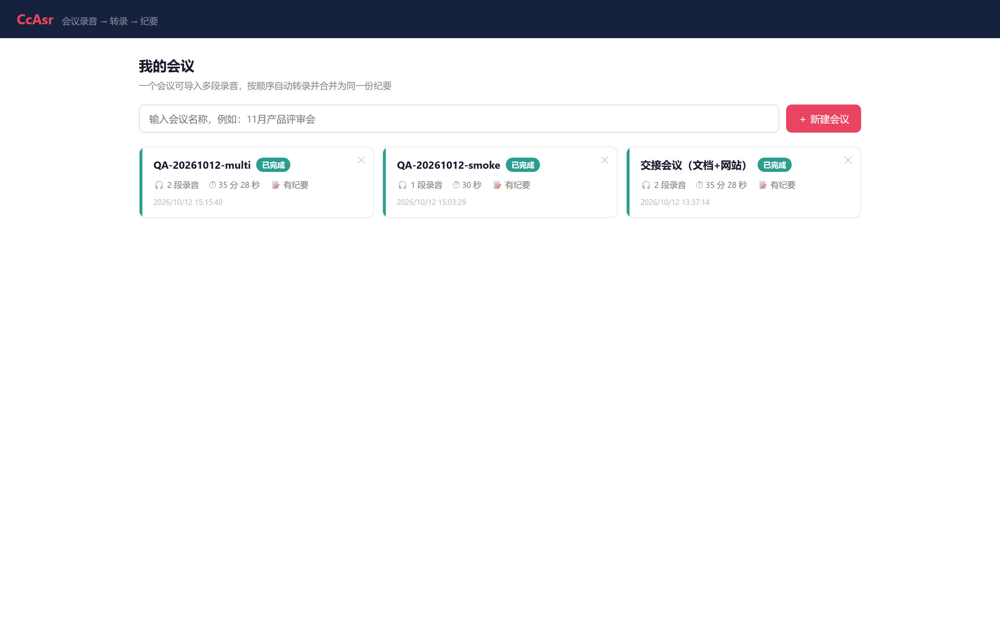
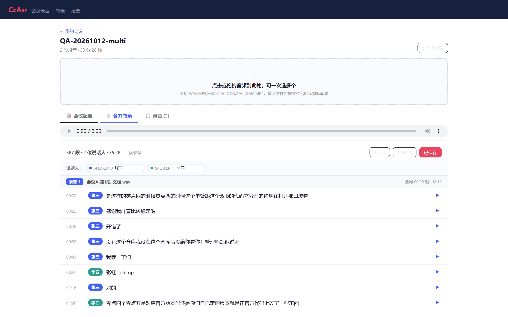
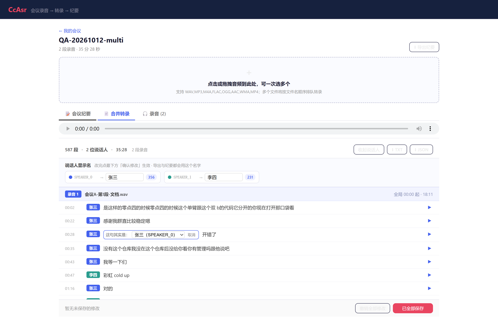
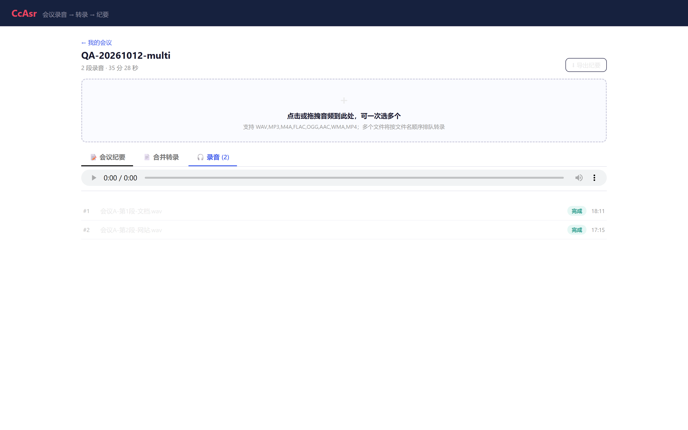

<div align="center">

# CcAsr

**会议录音 → 说话人分离转录 → 可追溯的会议纪要**

把一段长会议（或拆成好几段的录音）丢进来，得到一份**带说话人、带时间轴、结论能点回原声**的会议纪要。

[](https://www.python.org/)
[](https://fastapi.tiangolo.com/)
[](https://react.dev/)
[](https://www.typescriptlang.org/)
[](#多语种支持)
[](#测试)

[功能](#功能) · [截图](#界面) · [快速开始](#快速开始) · [使用流程](#使用流程) · [API](#api-接口) · [测试](#测试) · [FAQ](#常见问题)

</div>

---



## 这是什么

市面上的会议转录工具大多做三件事：转文字、分说话人、生成摘要。CcAsr 关注的是**长会议被拆成多段录音**这个真实场景，以及**纪要里的结论能不能回溯到原话**。

两个核心差异：

**1. 多段录音 = 一份文档**
一场 3 小时的会议常被录成 3 个文件。分别转录会得到 3 份各自从 `00:00` 开始、说话人编号还互相冲突的文稿。CcAsr 把它们**串行转录后合并成一份**：统一时间轴、统一说话人编号。

**2. 结论可点回原声**
纪要里每个章节都挂着时间戳徽章（`▶ 02:03`），点一下直接跳到那段原话播放。这些时间戳是后端**逐条校验过**的——只在转录里真的存在对应片段时才生成。**宁可没有证据，也不给假证据。**

<div align="center">



<sub>点纪要里的证据徽章 → 自动切到合并转录并播放对应位置</sub>

</div>

---

## 功能

### 转录

| 能力 | 说明 |
|---|---|
| **多段录音串行队列** | 一次选多个文件，按文件名顺序**串行**转录（不并发抢 CPU/GPU） |
| **跨录音说话人统一** | 汇总所有录音的声纹向量**全局重聚类**，全会议共用一套 `SPEAKER_x` |
| **统一时间轴** | `offset + local_start`，合并后时间连续，点任一句跳到正确音源 |
| **说话人分离** | CAM++ 声纹 + 谱聚类；簇数用**特征间隙（eigengap）**判定 |
| **情绪 / 语种检测** | SenseVoice 自带标签 |
| **文件去重** | MD5 存储，同一音频在不同会议复用不重复占空间 |
| **格式支持** | wav / mp3 / m4a / flac / ogg / aac / wma / mp4 |

### 纪要

| 能力 | 说明 |
|---|---|
| **自动生成** | 全部录音转录完成后自动触发，不需要点按钮 |
| **结构化版式** | 6 类组件：分栏色块 / 三线表格 / 垂直时间轴 / 流程条 / 待办表格 / 要点（参考腾讯会议元宝版式，[调研见 docs](docs/yuanbao-meeting-summary-research.md)） |
| **证据链** | 每个章节附可点击的原声时间戳，点击跳转播放 |
| **参考材料** | 上传议程、参会名单可提升人名与专有名词准确率 |
| **优雅降级** | LLM 不按格式输出时自动回退 Markdown，失败不影响转录 |

### 编辑与导出

转录完成后可以改三样东西，改完在**底部确认栏**汇总提交：

| 改什么 | 怎么改 |
|---|---|
| **说话人名** | 顶部「说话人显示名」：`SPEAKER_0` → `leader`，`SPEAKER_1` → `我`，全局生效 |
| **单句归属** | 点句首的说话人标签 → 选「这句其实是：」另一个人 |
| **文字** | 双击正文校对 |

改过的句子会**高亮**显示，底部实时汇总「待保存 N 处（文字 X 段 / 归属 Y 段 / 说话人名 Z 个）」，
点「确认修改」才写回；点「撤销全部修改」回到上次保存的状态。导出 **TXT / JSON / Markdown**，
导出与纪要都用改后的显示名。



<sub>改完未保存的状态：说话人已改为 leader、文字已校对，底部显示「待保存 2 处」</sub>

---

## 界面

### 我的会议

一个会议 = 一个文档，可导入多段录音。



### 合并转录

跨录音的统一时间轴。分隔条标出每段录音，右侧标注全局起止时间；说话人可改名，改名后**导出也用显示名**。



### 转录后修改

三项修改各就各位：顶部改说话人名、点标签改单句归属、双击改文字。改动先留本地，底部确认栏汇总后一次性提交。



<sub>点某句的说话人标签即可展开「这句其实是：」下拉，把这一句改判给别人</sub>

### 会议纪要

结构化版式 + 证据链。每个章节下方是校验过的原声时间戳。


### 录音队列

每段录音的处理状态一目了然；失败的段会显示错误原因，可重试。



> 截图由 `node app/scripts/capture-readme-shots.mjs` 自动生成（需后端运行）。

---

## 快速开始

详见 **[INSTALL.md](INSTALL.md)**。最简流程：

```bash
# 1) 依赖
uv sync                      # 或 pip install -e .

# 2) 配置 LLM（纪要需要；转录不需要）
cp .env.example .env
#    编辑 .env，至少填 CCASR_LLM_API_KEY 与 CCASR_LLM_MODEL

# 3) 启动后端
.venv\Scripts\python.exe run_server.py      # Windows
.venv/bin/python run_server.py              # macOS / Linux

# 4) 启动前端（新终端）
cd app && npm install && npm run dev
```

打开 <http://localhost:5173> 即可使用。

<details>
<summary>生产部署 / 不想开前端 dev server</summary>

```bash
cd app && npm run build     # 产出 app/dist
```

构建后后端会直接托管静态文件，只需访问 <http://localhost:8000>。
（已配置 SPA 回退，`/meetings`、`/meeting/{id}` 等深链接可直接访问或刷新。）

用 pm2 托管：

```bash
pm2 start ecosystem.config.js
pm2 reload all
```

Windows 用户也可直接双击 `start_backend.bat` / `start_frontend.bat`。

</details>

---

## 使用流程

```
① 新建会议        起个名字，例如「11月产品评审会」
      ↓
② 导入录音        拖拽或一次选多个；按文件名顺序排队
      ↓
③ 串行转录        队列逐段处理，「录音」Tab 看每段状态
      ↓
④ 自动合并        跨录音统一说话人 → 生成全局时间轴文档
      ↓
⑤ 自动纪要        全部转录完成后自动生成
      ↓
⑥ 校对导出        双击改文本 / 说话人改名 / 导出 TXT·JSON·Markdown
```

### 多段录音是怎么处理的

一场长会议拆成多段录音，直接分段转写会踩两个坑，这里都做了处理：

| 问题 | 处理方式 |
|------|----------|
| 同一人在不同录音里被编成不同 `SPEAKER_x` | 汇总所有录音的声纹向量**全局重聚类**，全会议共用一套编号 |
| 时间戳各自从 0 开始，无法定位 | 合并为**统一时间轴**（`offset + local_start`），点击任一句自动切到对应录音的对应位置 |

> 全局重聚类会排除时长 < 1 秒的片段——过短片段的声纹不可靠，会把聚类带偏。

**实测**（两段真实会议，共 35 分 28 秒）：

```
录音 #1  offset=0.00s      1091.73s   228 段
录音 #2  offset=1092.73s   1035.84s   359 段
─────────────────────────────────────────────
合并     587 段 · 2 位说话人 · 时间轴单调递增
两段标签集均为 {SPEAKER_0, SPEAKER_1}  ← 统一真的生效了
```

---

## 技术架构

```
┌───────────────────────────────────────────────────────────────┐
│ 前端   React 19 + TypeScript + Vite                           │
│   我的会议 ──→ 会议详情                                        │
│                多文件拖拽上传 · 队列进度                        │
│                Tabs: 会议纪要 / 合并转录 / 录音                 │
│                Virtuoso 虚拟滚动（587 段无卡顿）                │
│                共享 <audio>：纪要证据跳转 ↔ 转录点击播放        │
├───────────────────────────────────────────────────────────────┤
│ 后端   FastAPI + Python                                       │
│                                                               │
│   项目队列（严格串行）                                          │
│     录音1 → 录音2 → … → 录音N                                  │
│       每段:  VAD(fsmn-vad)                                    │
│              → ASR(SenseVoice) ∥ 声纹(CAM++)                  │
│              → 谱聚类（非负亲和矩阵 + eigengap 定簇数）         │
│                     ↓ 声纹向量落盘 .npy                        │
│     全部完成后:  跨录音全局重聚类                               │
│                → 合并统一时间轴                                 │
│                → LLM 生成结构化纪要                             │
│                → 校验证据时间戳（防编造）                       │
├───────────────────────────────────────────────────────────────┤
│ 硬件   CUDA / MPS 自动检测，无 GPU 回退 CPU 多核                │
└───────────────────────────────────────────────────────────────┘
```

---

## 多语种支持

默认按语言自动路由，无需配置：

| 语种 | 后端 | 说话人分离 |
|------|------|-----------|
| 中 / 粤 / 英 / 日 / 韩 | 本地 SenseVoice | ✅ 有 |
| 其它语种（法/德/西/俄/泰/越…） | 本地 faster-whisper | ❌ 无 |

用 `CCASR_ASR_ROUTING` 可强制指定：`auto`（默认）/ `sensevoice` / `whisper` / `doubao`。

**为什么这样分工**（均经实测）：

- **中文不走 faster-whisper**：实测 `tiny` 档把「语音识别」听成「**與因時別**」，中文需要 large 级才有竞争力，而 large 在 CPU 上很慢。SenseVoice 中文又快又准。
- **faster-whisper 不做说话人分离**：它本身不含 diarization，需要额外的 pyannote（gated 模型，商用条款未确认）。走该路径时说话人统一为 `SPEAKER_0`，日志与 `model_info.speaker` 都会标注。
- **台语/闽南语暂不支持**：Whisper 的 100 种语言表里有 `yue`（粤语）但**没有 `nan`**，SenseVoice 也只发布 zh/yue/en/ja/ko。要支持只能挂社区微调模型。

<details>
<summary>安装多语种依赖（可选）</summary>

```bash
.venv\Scripts\python.exe -m pip install -e ".[whisper]" --index-url https://pypi.org/simple
```

> ⚠️ **`av` 必须 < 19**。faster-whisper 的依赖只写 `av>=11` 没有上界，而 `av>=19` 删除了 `metadata_errors` 参数、faster-whisper 仍在调用它，装上最新版会在转写时抛 `TypeError`。`pyproject.toml` 已钉死该约束。
>
> ⚠️ 若 pip 配置了不可达的镜像（如 TUNA），会报 `No matching distribution found`。此时加 `--index-url https://pypi.org/simple`。

</details>

---

## 环境变量

复制 `.env.example` 为 `.env`：

| 变量 | 必填 | 说明 |
|------|:---:|------|
| `CCASR_LLM_API_BASE` | 是 | LLM API 地址（OpenAI 兼容），如 `https://api.deepseek.com` |
| `CCASR_LLM_API_KEY` | 是 | API Key（**只放 `.env`，不要提交**） |
| `CCASR_LLM_MODEL` | 是 | 模型名，如 `deepseek-chat` |
| `CCASR_LLM_MAX_CONTEXT` | 否 | 最大上下文 token |
| `CCASR_BACKEND` | 否 | `sensevoice`（默认，本地离线）/ `doubao`（云端） |
| `CCASR_ASR_ROUTING` | 否 | `auto`（默认）/ `sensevoice` / `whisper` / `doubao` |
| `CCASR_OUTPUT_DIR` | 否 | 输出目录，默认 `~/CcAsr/output` |
| `CCASR_DEBUG` | 否 | 设为 `1` 开启详细日志 |

> 🔒 `.env` 已被 `.gitignore` 忽略，从未入库。仓库里没有任何硬编码密钥。
>
> 旧版 `WINASR_*` 前缀仍兼容读取（会打印弃用警告），方便老用户迁移。
>
> ⚠️ **改完 `.env` 必须重启后端**——环境变量只在启动时加载一次。

### 配置自检

`GET /health` 会**不发网络请求**地告诉你配置哪里不对：

```json
"llm": {
  "ok": false,
  "problems": ["CCASR_LLM_API_KEY 仍是占位符，需填真实 key"],
  "warnings": ["模型名 'deepseek-flash' 不在 api.deepseek.com 的常见列表中"]
}
```

真实连通性用 `backend/tests/check_llm_live.py`（只发一次最小请求）。

---

## API 接口

| 方法 | 路径 | 说明 |
|------|------|------|
| `POST` | `/api/projects` | 创建会议（body: `{"name": "xx 会议"}`） |
| `GET` | `/api/projects` | 列出会议 |
| `GET` | `/api/projects/{id}` | 详情（含录音队列状态） |
| `PATCH` | `/api/projects/{id}` | 重命名 |
| `DELETE` | `/api/projects/{id}` | 删除会议及全部产物 |
| `POST` | `/api/projects/{id}/recordings` | **一次上传多个录音**（multipart，字段 `files`） |
| `POST` | `/api/projects/{id}/start` | 启动/继续队列；`retry_failed=true`（默认）会重试失败项 |
| `GET` | `/api/projects/{id}/transcript` | 合并转录（统一时间轴） |
| `PATCH` | `/api/projects/{id}/transcript` | 保存校对与说话人改名 |
| `POST` | `/api/projects/{id}/transcript/reassign` | **批量改判**：把某人的全部发言改给另一人（`{"from","to"}`） |
| `GET` | `/api/projects/{id}/summary` | 会议纪要（Markdown + 状态） |
| `POST` | `/api/projects/{id}/summary/regenerate` | 重新生成纪要 |
| `POST` | `/api/projects/{id}/reference` | 上传参考材料 |
| `GET` | `/api/projects/{id}/recordings/{rid}/audio` | 单段音频（支持 Range） |
| `GET` | `/api/projects/{id}/recordings/{rid}/transcript` | 单段录音的本地时间轴 |
| `GET` | `/api/projects/{id}/export?fmt=md\|txt\|json` | 导出 |
| `GET` | `/health` | 健康检查 + 配置体检 |

<details>
<summary>示例：建会议并导入多段录音</summary>

```bash
# 1) 建会议
PID=$(curl -s -X POST http://localhost:8000/api/projects \
  -H 'Content-Type: application/json' \
  -d '{"name":"11月产品评审会"}' | python -c "import sys,json;print(json.load(sys.stdin)['project_id'])")

# 2) 一次上传多个录音（按文件名顺序排队，自动开始串行转录）
curl -X POST "http://localhost:8000/api/projects/$PID/recordings" \
  -F "files=@part1.m4a" -F "files=@part2.m4a" -F "files=@part3.m4a" \
  -F "language=zh"

# 3) 查询进度（state: draft → transcribing → summarizing → completed）
curl -s "http://localhost:8000/api/projects/$PID"

# 4) 取纪要与合并转录
curl -s "http://localhost:8000/api/projects/$PID/summary"
curl -s "http://localhost:8000/api/projects/$PID/transcript"
```

**分批上传**：`start=false` 先入队、不启动，攒齐后再 `POST /start`。此时项目状态保持 `draft`，不会被并发保护挡住。

> ⚠️ 队列**运行中**再次上传返回 `409`，避免多段录音并发争抢 CPU/GPU。等当前队列跑完再传。

</details>

---

## 性能参考

| 音频时长 | 处理耗时 | RTF |
|----------|----------|-----|
| 4 min | ~15 s | ~0.06 |
| 35 min（两段合并） | ~168 s | ~0.08 |
| 103 min | ~14 min | ~0.14 |

> RTF < 1 表示快于实时。优化：ASR + 声纹并行、GPU 加速（CUDA/MPS 自动检测）、非 WAV 预转码。
>
> 实测环境：Windows / CPU-only / 16 核。**仅代表缓存已热的 CPU 环境**，不同硬件差异较大。

用下面这个脚本可对任意会议出量化报告：

```bash
.venv\Scripts\python.exe backend\tests\quality_metrics.py <会议ID>
```

输出段数、说话人分布、段长分布、时间轴单调性、**各录音标签集是否相同**、纪要版式分布、**证据覆盖率**、待办数、峰值内存，并明确列出**未度量项**（CER/WER、DER、定位误差——这些需要人工标注语料，不做自动声明）。

---

## 项目结构

```
CcAsr/
├── backend/
│   ├── app.py             # FastAPI 入口（会议项目 API + SPA 托管）
│   ├── project_store.py   # 项目/录音管理 + 串行队列 + 跨录音说话人统一
│   ├── meeting_summary.py # 纪要生成（结构化组件 + 证据链校验 + MD 降级）
│   ├── pipeline.py        # 核心 Pipeline（VAD → ASR + 声纹 → 聚类）
│   ├── backends.py        # ASR 后端路由（SenseVoice / faster-whisper / 豆包）
│   ├── whisper_backend.py # faster-whisper 后端
│   ├── config.py          # 配置解析（CCASR_* + 旧 WINASR_* 兼容）
│   ├── schema.py          # 数据模型（Project / Recording / Segment）
│   ├── file_store.py      # 文件管理（MD5 去重 + 元数据）
│   └── tests/             # 测试（见「测试」章节）
├── app/                   # React 前端
│   ├── src/components/
│   │   ├── MeetingListPage.tsx     # 我的会议
│   │   ├── MeetingDetailPage.tsx   # 会议详情 + 共享播放器
│   │   ├── TranscriptWorkspace.tsx # 合并转录（跨录音回放 + 校对）
│   │   └── SummaryView.tsx         # 纪要渲染（8 类组件 + 证据徽章）
│   └── scripts/           # 测试启动器 + README 截图脚本
├── docs/
│   ├── images/            # README 配图（含演示 GIF）
│   ├── yuanbao-meeting-summary-research.md   # 元宝纪要版式调研
│   └── test-report-*.md   # QA 测试报告
├── samples/               # 测试音频（不入库）
├── output/                # 输出目录（默认 ~/CcAsr/output）
│   ├── files/             #   上传音频（MD5 命名，去重）
│   └── projects/{id}/     #   每场会议
│       ├── recordings/    #     各段结果 JSON + 声纹 .npy
│       ├── transcript.json#     合并转录（统一时间轴 + 说话人改名）
│       └── summary.md     #     会议纪要（内嵌结构化组件）
├── .env                   # 环境变量（不提交）
├── run_server.py          # 启动脚本（--debug）
├── CHANGELOG.md           # 更新日志
├── TESTING.md             # 测试人员手册
└── pyproject.toml
```

---

## 测试

一键跑完后端全部测试（**不需要 API key、不需要启动服务**）：

```bash
.venv\Scripts\python.exe backend\tests\run_all.py     # Windows
.venv/bin/python backend/tests/run_all.py             # macOS / Linux
```

```bash
cd app && npm run test:fe     # 前端
cd app && npm run lint        # ESLint
```

当前状态：**后端 7 套件 / 151 项断言全通过 · 前端 24 项 · ESLint 0 错误**。

| 套件 | 覆盖内容 | 依赖 |
|------|----------|------|
| `test_meeting_summary.py` | 纪要管道：JSON 提取 / 代码围栏 / 夹带解释 / 两次失败降级 / 重试 | 注入假 LLM |
| `test_llm_config_check.py` | 配置体检：缺 key / 占位符 / 模型名笔误 / base 异常 | 纯函数 |
| `test_routing.py` | ASR 路由：语种覆盖 / 强制指定 / 环境变量优先级 / 容错 | 纯函数 |
| `test_summary_e2e_selfcontained.py` | **全链路**：多文件上传→串行队列→跨录音统一→合并→自动纪要→导出→删除 | 假 ASR + 假 LLM |
| `test_transcript_editing.py` | 校对 / 改名 / **导出用显示名** / 且不误改其它段 / 404 语义 | 假 ASR |
| `test_edge_cases.py` | 分批上传 / 空项目 / 内容非音频 / 特殊文件名与导出净化 / 重命名 | 假 ASR |
| `test_evidence_chain.py` | 证据链：时间归一化 / 容差 / **防编造** / 去重 / 向后兼容 | 纯函数 |
| `frontend_verify.mjs` | 结构化解析 / 降级路径 / XSS 转义 / 时间格式化 | vite 转译 |

<details>
<summary>需要外部条件的测试</summary>

```bash
# 真实音频端到端（需后端已启动，用 samples/ 的音频真跑一遍）
.venv\Scripts\python.exe backend\tests\acceptance_e2e.py

# LLM 真实连通性（填好 key 后跑，只发一次最小请求）
.venv\Scripts\python.exe backend\tests\check_llm_live.py

# 质量与性能量化报告
.venv\Scripts\python.exe backend\tests\quality_metrics.py <会议ID>
```

> `CCASR_LLM_FAKE=1` 可让后端使用**假 LLM 客户端**，仅用于验证纪要链路。默认关闭，生产部署不受影响。

</details>

---

## 常见问题

<details>
<summary><b>模型加载很慢？</b></summary>

首次运行需从 ModelScope 下载模型（~1GB），之后走缓存。首次启动看起来像"卡住"是正常的。
</details>

<details>
<summary><b>说话人分离不准 / 所有人都是同一个 SPEAKER？</b></summary>

聚类失败时会降级为单一说话人，日志中出现 `声纹聚类失败`。判据是**特征间隙（eigengap）**：样本过少或片段普遍过短时会判不准。若持续出现请附日志反馈。
</details>

<details>
<summary><b>多段录音里同一个人被编成不同的 SPEAKER_x？</b></summary>

正常情况下不应发生——队列结束后会自动做**跨录音全局重聚类**。若仍出现，检查各段录音是否有足够长的语音（< 1 秒的片段不参与全局聚类）。
</details>

<details>
<summary><b>会议纪要没生成？</b></summary>

先看 `GET /health` 的 `llm` 字段，它会直接指出问题。常见原因：key 未填/仍是占位符、模型名笔误（例如 DeepSeek 并没有 `deepseek-flash`，应为 `deepseek-chat`）。**转录本身不需要 LLM，不受影响。**
</details>

<details>
<summary><b>纪要生成失败会影响转录结果吗？</b></summary>

不会。转录是独立阶段，纪要在其后执行且失败被捕获，状态标记 `summary_state=failed`，转录与合并文档照常可用。已生成转录的会议可在纪要 Tab 点「重新生成」，**不需要重跑转录**。
</details>

<details>
<summary><b>纪要里的证据徽章数量比章节数少？</b></summary>

这是**预期行为**。时间戳会逐条校验，只有当该时间点附近真的存在转录片段时才生成证据——找不到明确出处的章节就不给证据，避免编造。
</details>

<details>
<summary><b>GPU 没被用上？</b></summary>

`/health` 的 `device` 字段显示实际设备。无 NVIDIA GPU 时自动回退 CPU（多核并行），MPS 仅 macOS Apple Silicon 可用。
</details>

<details>
<summary><b>豆包云端后端能用吗？</b></summary>

**当前流程不可用**，请勿开启 `CCASR_ASR_ROUTING=doubao`。火山引擎只接受**公网音频 URL**，与"上传本地录音"的流程不兼容，会在每个任务上报错。接口实现保留，待接入对象存储后再启用。
</details>

<details>
<summary><b>Debug 模式？</b></summary>

```bash
.venv\Scripts\python.exe run_server.py --debug
# 或
CCASR_DEBUG=1
```
</details>

<details>
<summary><b>参考材料有什么用？</b></summary>

上传议程、参会名单等材料后，纪要生成时会作为背景信息，有助于正确理解人名、议题与专有名词。在纪要 Tab 上传，然后点「重新生成」。
</details>

---

## 已知限制

| 限制 | 说明 |
|------|------|
| 台语 / 闽南语 | 不支持。主流模型均无此语种 |
| 非中英日韩粤语种 | 自动切 faster-whisper，但**该路径不做说话人分离** |
| 说话人数量 | 自动判定（eigengap），最多 10 人。人数极多或片段极短时可能不准 |
| 并发 | 同一会议队列**串行**；运行中不能追加录音 |
| 时间轴基线 | `duration` 记录的是**有效语音结束时间**，不是音频文件字节长度（两者可能差几十秒的尾部静音） |
| 波形图 | 合并转录视图不显示波形（跨多个音频文件），但可正常播放与定位 |

---

## 许可

仅供内部使用。
