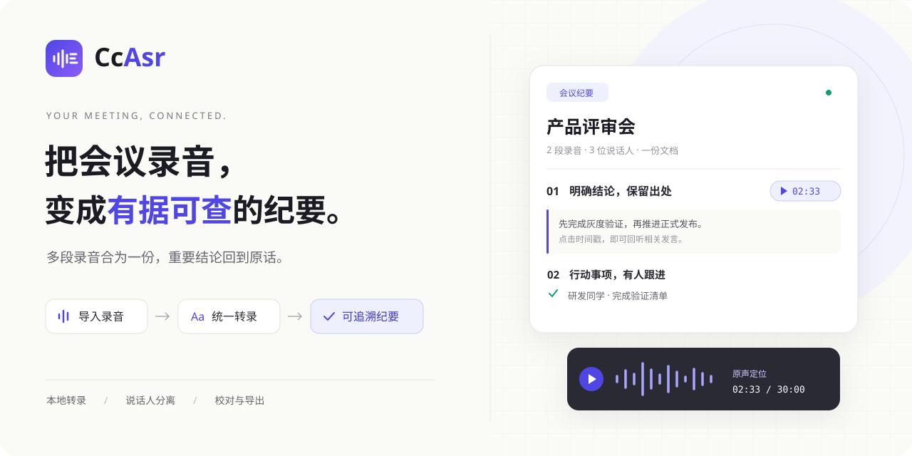
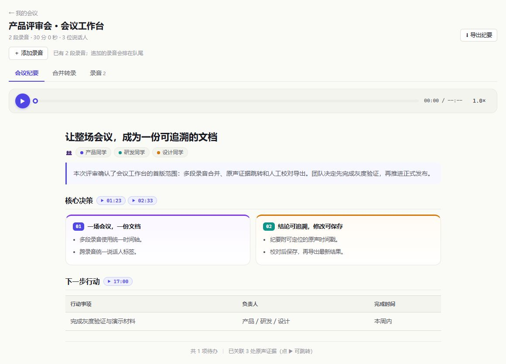
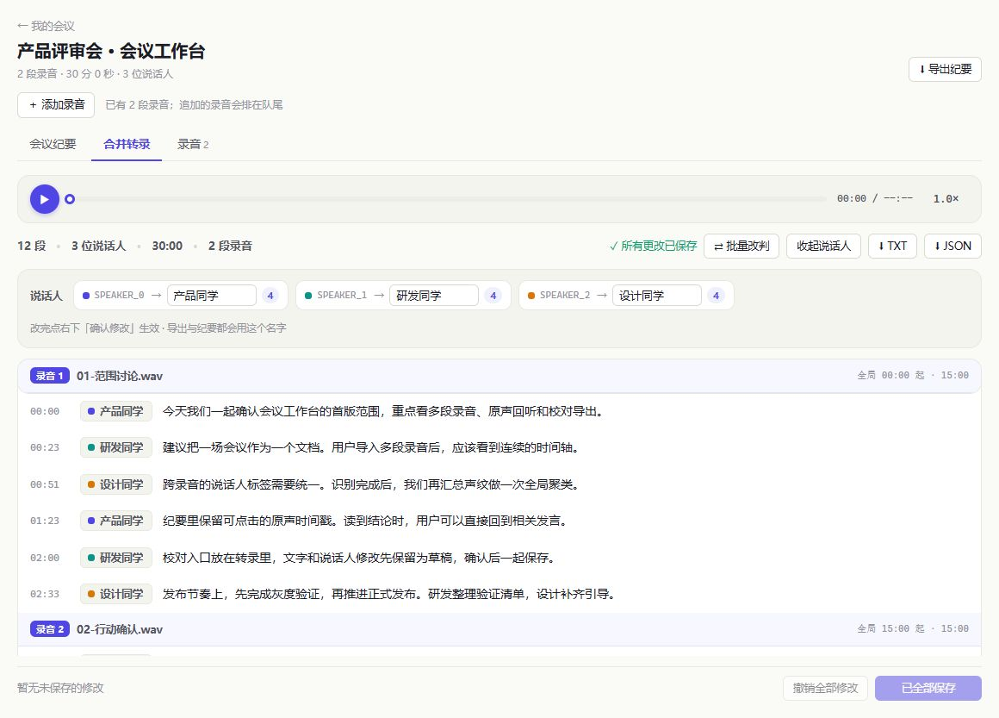

<div align="center">



<br />

**本地转录 · 说话人分离 · 可追溯纪要**

把一场会议的多段录音，整理成一份可以校对、回听和导出的文档。


[功能亮点](#功能亮点) · [界面预览](#界面预览) · [快速开始](#快速开始) · [文档](#文档)

</div>

## 为整场会议而设计

CcAsr 是一个可自行部署的会议录音工作台。它按会议组织录音，完成转录、跨录音说话人统一和纪要生成，让讨论的上下文留在同一份文档里。

**三段录音，一份纪要。一个结论，回到原话。**

| 多段录音，连成一场会议 | 读到结论，也能找到出处 | 自动整理，保留人工校对 |
| :--- | :--- | :--- |
| 批量导入、串行转录，合并为统一时间轴；跨录音统一说话人编号。 | 纪要章节可附原声时间戳，点击定位到对应录音与转录片段。 | 校对文字、重命名说话人、调整发言归属，确认保存后导出。 |

## 界面预览

### 从讨论到决策

纪要按议题、结论和待办组织内容。标题旁的时间戳把摘要与原始发言连接起来。



### 从纪要回到原话

在合并转录中查看上下文、播放原声和校对文字。不同录音的说话人标签与时间轴保持统一。



<sub>以上为当前应用界面的截图，使用虚构的产品评审会议数据展示功能。配图说明见 <a href="docs/images/README.md">docs/images</a>。</sub>

## 功能亮点

| 能力 | 使用体验 |
| :--- | :--- |
| **多段录音合并** | 一次导入多个文件，按文件名排序，逐段转录后汇总成会议文档。 |
| **跨录音说话人统一** | 汇总声纹特征重新聚类，让整场会议使用同一套说话人标签。 |
| **结构化纪要** | 自动生成议题、分栏、表格、时间轴和待办；支持补充议程、参会名单等文本材料。 |
| **原声证据跳转** | 校验引用时间点是否对应转录片段；有匹配出处时显示可点击的时间戳。 |
| **校对与修订** | 双击编辑文字，修改说话人显示名，单句或批量调整归属；草稿支持撤销与统一保存。 |
| **按需导出** | 导出 Markdown 纪要、TXT 转录或 JSON 数据，保存后的校对与显示名随导出保留。 |
| **本地语音识别** | 中、粤、英、日、韩使用 SenseVoice + CAM++；其他语种可选 faster-whisper。 |

> 本地转录在模型下载完成后可离线运行。生成纪要需要配置 OpenAI 兼容的 LLM；使用云端 LLM 时，转录文本和参考材料会发送到所配置的服务。

## 快速开始

需要 **Python 3.12+、Node.js 22.12+、uv 和 ffmpeg**。各平台的详细步骤见 [安装指南](INSTALL.md)。

**1. 获取代码并安装后端依赖**

```bash
git clone https://github.com/Xuzc317/ASR.git CcAsr
cd CcAsr
uv sync
```

**2. 配置纪要服务（只使用转录可跳过）**

复制 `.env.example` 为 `.env`，填写实际服务地址、API Key 和模型名：

```dotenv
CCASR_LLM_API_BASE=https://your-provider.example/v1
CCASR_LLM_API_KEY=REPLACE_WITH_YOUR_API_KEY
CCASR_LLM_MODEL=your-model-name
```

**3. 启动后端**

```bash
uv run python run_server.py
```

**4. 在新终端进入仓库的 app 目录，启动前端**

```bash
cd app
npm ci
npm run dev
```

打开 **[localhost:5173](http://localhost:5173)**，新建会议并导入录音。首次转录会下载模型，之后复用本地缓存。

<details>
<summary><strong>构建后由后端统一提供页面</strong></summary>

在 `app/` 中执行 `npm run build`，然后从仓库根目录启动或重启后端：

```bash
uv run python run_server.py
```

访问 [localhost:8000](http://localhost:8000)，后端会托管 `app/dist/`，并支持前端路由刷新。

</details>

## 一场会议的整理流程

**新建会议 → 导入录音 → 自动转录与合并 → 生成纪要 → 校对、回听、导出**

1. 给会议命名，导入一段或多段录音。
2. 在「录音」页查看进度；全部转录结束后，系统合并文档并尝试生成纪要。
3. 阅读纪要，点击时间戳回听原声；在「合并转录」中校对文字和说话人。
4. 确认保存修改；如纪要提示待更新，重新生成后导出。

具体操作见 [使用指南](docs/USAGE.md)。

## 使用前了解

- **说话人分离适用于 SenseVoice 路径。** faster-whisper 路径当前不做说话人分离；人数较多、发言过短或重叠时，结果仍需校对。
- **证据时间戳用于定位原话。** 校验的是转录片段与时间点的匹配，不能保证摘要语义正确，关键结论请结合原声确认。
- **同一会议按串行队列处理。** 队列运行时不能追加录音；完成后可继续添加。
- **豆包接口暂不适用于本地文件上传。** 当前工作台请使用本地识别后端。

更多配置和排查方式见 [安装指南](INSTALL.md#常见问题) 与 [架构说明](docs/ARCHITECTURE.md)。

## 文档

| 我想… | 从这里开始 |
| :--- | :--- |
| 安装、配置模型或部署 | [安装指南](INSTALL.md) |
| 导入录音、校对和导出 | [使用指南](docs/USAGE.md) |
| 了解识别、聚类与纪要链路 | [架构说明](docs/ARCHITECTURE.md) |
| 通过脚本调用服务 | [API 参考](docs/API.md) |
| 开发前端或运行检查 | [前端开发](app/README.md) · [测试说明](TESTING.md) |
| 查阅设计与历史记录 | [设计规范](docs/design/CcAsr-UI-Redesign.html) · [更新记录](CHANGELOG.md) |

## 项目与许可

本仓库目前仅供内部使用，未提供开源许可证。

语音识别基于 [FunASR](https://github.com/modelscope/FunASR)、[SenseVoice](https://github.com/FunAudioLLM/SenseVoice) 与 [CAM++](https://github.com/modelscope/3D-Speaker)；可选多语种后端使用 [faster-whisper](https://github.com/SYSTRAN/faster-whisper)。各模型与依赖的使用条款以其上游项目为准。
