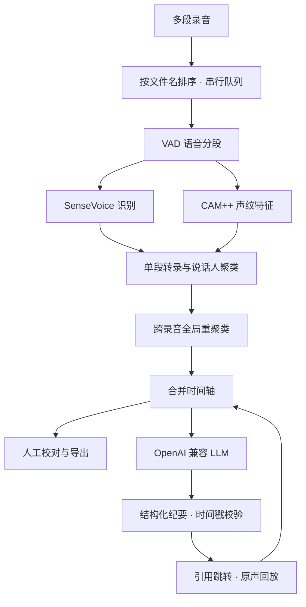

# 架构说明

[项目首页](../README.md) · [安装指南](../INSTALL.md) · [API 参考](API.md)

## 默认处理链路



faster-whisper 路径只提供转录与时间戳，当前没有声纹与说话人分离。

## 技术栈

| 层 | 实现 |
| :--- | :--- |
| 前端 | React 19、TypeScript 6、Vite 8、React Router 7、react-virtuoso |
| 样式 | 原生 CSS 与设计令牌，浅色纸面工作台 |
| 服务 | FastAPI、Python 3.12+、项目级串行队列 |
| 识别 | FunASR、fsmn-vad、SenseVoiceSmall |
| 说话人 | CAM++ embedding、谱聚类、eigengap 簇数判定 |
| 可选识别 | faster-whisper / CTranslate2 |
| 纪要 | OpenAI 兼容 Chat Completions 服务 |
| 数据 | 文件系统、JSON 文档与声纹向量 .npy |

## 合并与回放

单段识别保存声纹特征；队列结束后汇总特征重新聚类，用全局标签替换各录音独立的编号。不足 1 秒的声纹片段不参与全局聚类。

合并文档同时保留全局时间和录音内时间：阅读用统一时间轴，回放用 `recording_id` 与 `local_start` 定位文件。合并偏移基于有效语音结束时间，可能不包含原文件尾部静音。

## 纪要与证据

LLM 接收转录、说话人显示名与可选参考材料。结构化 JSON 以 HTML 注释嵌入 Markdown，前端解析并渲染版式；格式异常时重试，仍无法解析则回退文本。

引用时间点需匹配现有转录片段，成功后补录音编号、片段 ID 与本地时间。这防止无法定位的时间点进入界面，但不验证摘要语义。

当前转录输入最多取 120,000 字符，参考材料最多取 8,000 字符；极长会议可能截断。`CCASR_LLM_MAX_CONTEXT` 当前未用于该限制。

## 保存协议与存储

前端 reducer 管理保存基线、草稿与改动计数。后端采用项目写锁、修订号与原子文件替换，避免旧页面覆盖和写入中断。

默认存储在 `~/CcAsr/output/`，可用 `CCASR_OUTPUT_DIR` 修改。上传文件按 MD5 去重，会议元信息、转录、纪要与声纹产物保存在输出目录。导出与纪要优先读取已保存的合并转录；修订后标记 `summary_stale`。

## 目录与边界

```text
backend/       API、识别、队列、配置、存储与纪要
app/           React 工作台、验证与截图脚本
docs/          使用、API、架构、设计与验收记录
run_server.py  服务启动入口
```

- 同一会议串行处理，运行时不能追加录音。
- 自动说话人数默认上限 10 人，噪声、短片段和重叠发言会降低效果。
- faster-whisper 不做说话人分离；当前没有专门的台语 / 闽南语支持。
- 合并视图没有单一波形，按原录音切换回放音源。
- 豆包需要公网音频 URL，尚未接入本地上传链路。
- 应用没有账号与权限系统，适合受控的本机或内网环境。

验证见 [测试说明](../TESTING.md)。历史报告对应各自版本，不代表所有硬件与音频条件的性能。
